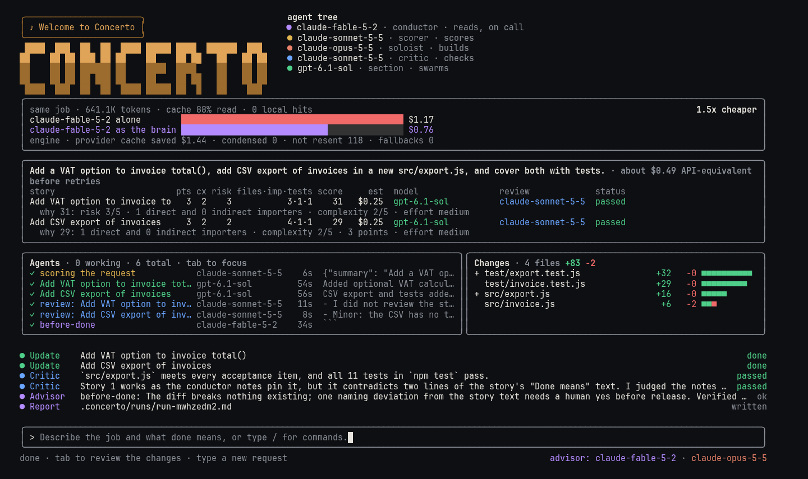
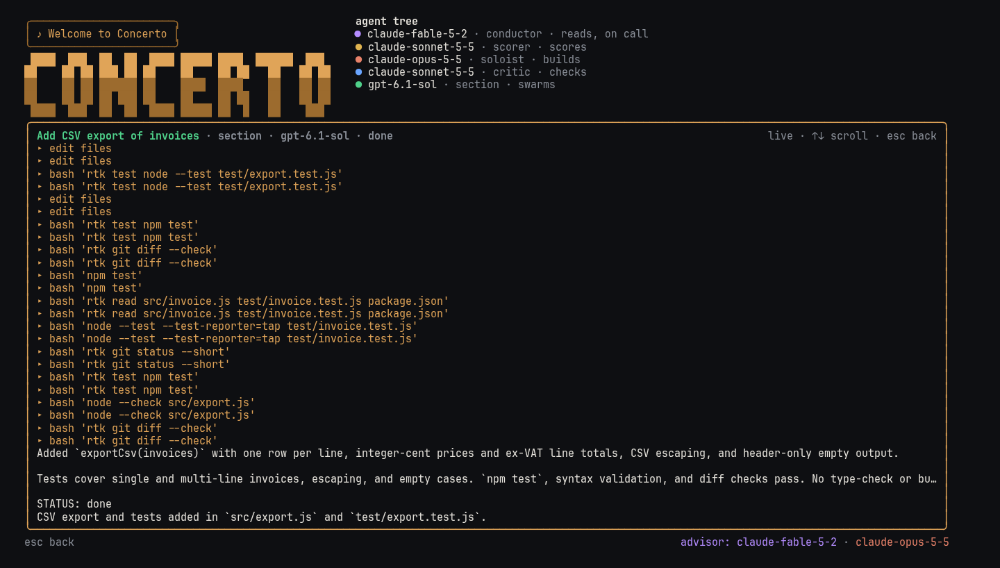
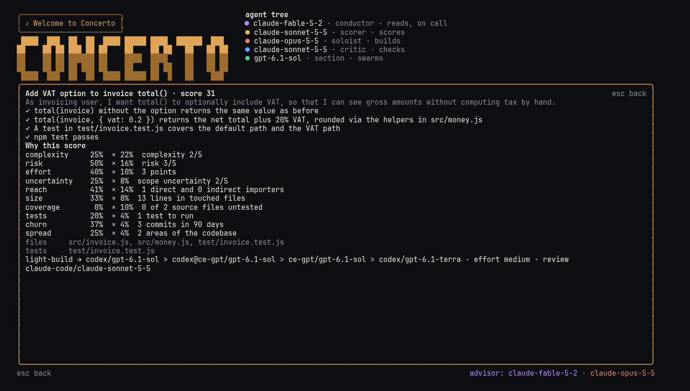
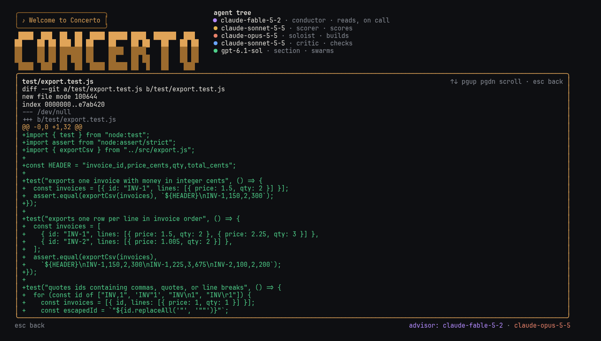
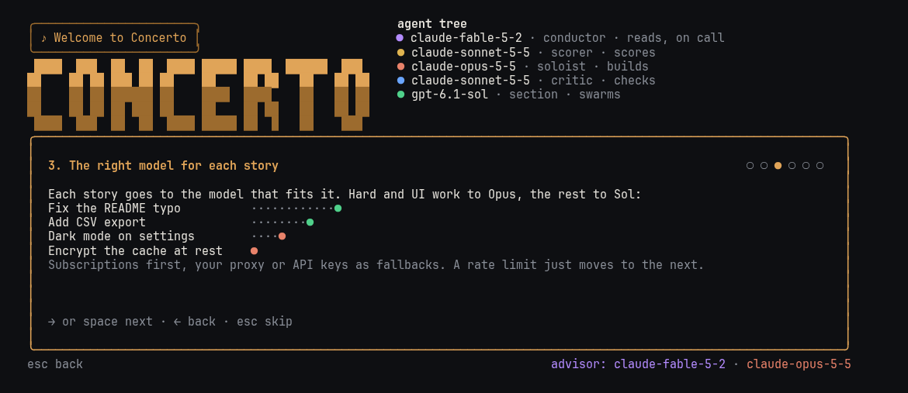

<p align="center">
  
</p>

<p align="center">
  <a href="https://github.com/RemiPelloux/Concerto/actions/workflows/ci.yml"></a>
  <a href="https://remipelloux.github.io/Concerto/"></a>
  
  
  <a href="LICENSE"></a>
</p>

# Concerto

You describe a coding job in your terminal. Concerto splits it into user stories, measures how much
of your repository each one touches, and sends each story to the model that fits it. Opus 5.5
builds the hard and UI stories, GPT-6.1 Sol the middle ones, Haiku 5.5 the small ones. A critic tries to break every story, and
Fable 5.2 checks the plan at three checkpoints.

It runs on your Claude Code and ChatGPT subscriptions, and on any API key pi holds. Concerto never
sees a key. Full documentation: [remipelloux.github.io/Concerto](https://remipelloux.github.io/Concerto/)

## Screenshots

<p align="center"></p>

| | |
|---|---|
|  |  |
| An agent's live output | Why a story got its score |
|  |  |
| A changed file's diff | The animated tour (`/onboarding`) |

## Install

You need git, Node 22+, and at least one of these logged in: `claude` (Claude Code), `codex`
(Codex), `pi`.

```sh
curl -fsSL https://raw.githubusercontent.com/RemiPelloux/Concerto/main/scripts/install.sh | sh
```

This puts a checkout in `~/.local/share/concerto`, a `concerto` command in `~/.local/bin`, and
Concerto's skills in the agents it finds (Claude Code, Codex, pi). Run it again to update. Read the
[script](scripts/install.sh) first if you prefer; it needs no sudo.

## Quick start

Go to a project, ideally on a clean branch or a git worktree, because agents edit the files there:

```sh
cd ~/code/my-app
concerto
```

The first launch tests every model you have with one tiny prompt, keeps the ones that answer, asks
whether calls go through your subscriptions, your proxy or your API keys first, then plays a short
animated tour. Type a request, for example `Add CSV export to invoices. Done means: the tests
pass.`, press Enter to see the scored stories, and Enter again to build them.

## Commands

| Command | What it does |
|---|---|
| `concerto` | Start the terminal UI |
| `concerto "request"` | Start with a request already typed |
| `concerto --plan "request"` | Show the scored stories as JSON, build nothing |
| `concerto --run "request"` | Score and build without the UI, for scripts and CI |
| `concerto --orca "request"` | Start the run in a new Orca worktree, in its own tab |
| `concerto --budget 5 ...` | Stop starting stories after $5 of API-equivalent spend |
| `concerto --prefer 'ce-*' ...` | Try your proxy first for every model |
| `concerto --init` | Detect and test your models again, rewrite your config |
| `concerto --probe` | Retest the configured models |
| `concerto --doctor` | What is installed, linked, skipped, and why |
| `concerto --stats` | Tokens, cache hits and savings for this repository |
| `concerto --install-skills` | Teach the agents on this machine to use Concerto |

After a build, the report is in `.concerto/runs/`, ready to paste into a pull request.

Every launch has a session id, shown in the status line and in any error. Its log,
`.concerto/logs/<id>.log`, records the models in use, each phase, every agent's output and each
error with its stack: attach it when you report a bug. `.concerto/` is kept out of commits through
the repository's local git exclude.

## Inside the TUI

| Key | What it does |
|---|---|
| Enter | Score the request; Enter again builds the plan |
| Tab | Move between the prompt, the agents, the stories and the changed files |
| ↑ ↓ | Pick an agent, a story or a file |
| Enter on an agent | Its live output: what it reads, runs and says, as it happens |
| Enter on a story | Why it got its score: every factor, the files, the covering tests |
| Enter on a file | Its diff |
| Esc | Close, go back to the prompt, discard a plan, or stop a build |

Type `/` for commands, with suggestions as you type and Tab to complete:

| Command | What it does |
|---|---|
| `/onboarding` | Replay the animated tour |
| `/setup` | Detect and test your models again, then pick the routing |
| `/config` | The config in use: file, provider preference, budget, routes |
| `/models` | Each role's model chain and how stories route |
| `/doctor` | Models skipped after a failed probe, and why |
| `/probe` | Test every installed model again |
| `/session` | This session's id and the path of its log |
| `/budget 5`, `/prefer ce-*` | Change the budget or the provider order for this session |
| `/reload`, `/stats`, `/orca <request>`, `/clear`, `/quit`, `/help` | The rest |

## Who does the work

Concerto starts the agents itself. For every story it runs a builder (`claude -p`, `codex exec` or
`pi -p`) as a background process in the project folder, then a critic the same way, and the
conductor at its checkpoints. You do not open them, and they do not appear as separate tabs: you
watch them in Concerto's screen, and their work shows up as changes in the folder. Concerto never
commits; you review the diff.

## Teach your agents

`concerto --install-skills` (the installer runs it) adds three skills to Claude Code, Codex and pi:

- `concerto`: when to hand a job to Concerto, which command to run, how to read the plan and the
  report.
- `concerto-config`: changing routes, models, provider preference and budget.
- `concerto-doctor`: fixing skipped models, failed logins, rate limits and failed runs.

Then ask any of them, for example, "plan this with Concerto" or "build it with Concerto in a new
Orca worktree".

## Use with Orca

- **From any Orca terminal:** `concerto --orca "request"` creates a fresh worktree of the current
  repository and starts Concerto in a new tab there, so the run never touches your branch.
- **One click:** in Orca, open Settings, then the terminal quick commands, and add a command with
  the label `Concerto` and the command `concerto`. It opens the TUI in the current worktree.
- **From your agents:** with the skills installed, Claude Code, Codex or pi running in Orca call
  `concerto --plan` or `concerto --orca` when you ask them to.

## How a story is scored

The scorer model writes each story with points, complexity, risk, scope uncertainty and the files
it will touch. Concerto then measures those files in your repository and computes a score from 0
to 100 from ten factors:

| From the model | Weight | Measured in the repository | Weight |
|---|---|---|---|
| Complexity | 22% | Reach: files importing them, direct ones count double | 14% |
| Risk, never below 4/5 for auth, payments, migrations, CI | 16% | Coverage gap: touched code with no test | 10% |
| Effort (story points) | 10% | Size of the touched files | 8% |
| Scope uncertainty | 8% | Tests to run, churn over 90 days, areas touched | 4% each |

Tests come from [SmartTest](https://github.com/RemiPelloux/SmarttyTest) when the repository uses it,
otherwise from Concerto's own import graph (TypeScript, JavaScript, Python). A misremembered path is
matched to the real file. If a story names no file, the model's four factors decide alone. Every
score comes with its top three reasons, for example `why 64: complexity 4/5 · touches
src/auth/session.ts · 2 of 2 source files untested`.

The score picks the builder and its effort:

| Story | Builder | Reviewer |
|---|---|---|
| UI or UX | Opus 5.5 | GPT-6 Astra |
| Score 55 or more | Opus 5.5 | Sonnet 5.5 |
| Score 25 to 54 | GPT-6.1 Sol | Sonnet 5.5 |
| Score under 25 | Haiku 5.5 | Sonnet 5.5 |

Effort follows the score: low under 25, medium under 50, high under 75, extra high above. Each
model has a fallback chain, so a rate limit or an outage moves the call to the next way of reaching
the same model. A story that fails review twice wakes the conductor, and its advice goes into one
last attempt.

## Saving tokens

- Claude Code starts without your plugins and MCP servers: about 600 tokens of context, not 131,000.
- System prompts are byte-identical between calls, so provider caches keep hitting.
- A resumed session is not sent what it already has.
- Critiques and logs lose noise (ANSI codes, spinners, repeated lines) before going back to a model.
- Scoring the same request twice is answered from a local cache, with no tokens spent.
- Agents are told to use [rtk](https://github.com/rtk-ai/rtk) when it is installed.

## Configuration

Your config is `~/.config/concerto/config.json`, written by the first launch. A
`concerto.config.json` in a project overrides it. Edit the routes, model chains, tiers, budget or
skills there. [examples/concerto.config.full.json](examples/concerto.config.full.json) shows a full
one with 37 working models.

Model names look like `claude-code/claude-opus-5-5` (Claude subscription), `codex/gpt-6.1-sol`
(ChatGPT subscription), `codex@ce-gpt/gpt-6.1-sol` (a Codex profile, such as a proxy), or
`openai/gpt-6.1-sol` (any provider in pi).

## Cheaper API access

When your subscriptions run out, an API gateway that serves GPT, Claude, DeepSeek and Grok behind
one key is the simplest fallback. I use [CodexEverywhere](https://codex-everywhere.com/home?aff=H9TB6LJQJMEU).
Add it to pi or as a Codex profile with providers named `ce-gpt`, `ce-claude`, `ce-deepseek` and
`ce-grok`, and Concerto picks them up.

*Affiliate link: I get a commission if you sign up through it, at no cost to you. Any
OpenAI-compatible provider works the same way.*

## Roadmap

What is missing and what comes next: [ROADMAP.md](ROADMAP.md).

## Development

```sh
git clone https://github.com/RemiPelloux/Concerto && cd Concerto
pnpm install && git config core.hooksPath .githooks
pnpm dev                           # run from source
pnpm check                         # types, lint, tests, Pelloux audit
```

Imports use the `#src/...` alias (package.json `imports`), never `../..` paths: the `source`
condition points them at TypeScript in development and tests, and at `dist/` once built. The code
follows the [Pelloux Guidelines](https://github.com/RemiPelloux/pelloux-guidelines). The
pre-commit hook runs the tests your change can reach, through SmartTest. Security notes are in
[SECURITY.md](SECURITY.md).

## License

MIT
