<p align="center">
  
</p>

<p align="center">
  <a href="https://github.com/RemiPelloux/Concerto/actions/workflows/ci.yml"></a>
  <a href="https://remipelloux.github.io/Concerto/"></a>
  
  
  
  <a href="LICENSE"></a>
</p>

# Concerto

Concerto is a terminal orchestrator for coding agents. You describe a job, a scorer model splits
it into user stories with points, complexity and risk, and each story goes to the model that fits
it: Opus 5.5 for hard and UI work, GPT-6.1 Sol for the rest. A critic tries to break every story
before it counts as done, and GPT-6 Astra reviews the UI ones. Fable 5.2 conducts. It reads the
whole session at three checkpoints, its guidance goes back to the builders, and it never writes
code.

It runs on what you already pay for: your **Claude Code** subscription, your **ChatGPT**
subscription through Codex, an OpenAI-compatible **proxy** through a Codex profile, and every
provider in [pi](https://github.com/badlogic/pi-mono) (Anthropic, OpenAI, DeepSeek, Grok, custom
endpoints). Concerto never sees an API key. When a model fails or hits a rate limit, the call moves
to the next model in its chain.

A token engine sits between Concerto and the models. It orders prompts so provider caches keep
hitting, does not resend context a session already has, condenses feedback before it goes back
into a prompt, and answers repeated read-only calls from a local cache.

Documentation: [remipelloux.github.io/Concerto](https://remipelloux.github.io/Concerto/)

## Usage

```sh
git clone https://github.com/RemiPelloux/Concerto && cd Concerto
pnpm install

pnpm dev                                        # the TUI
pnpm dev "Move the API to Rust. Done means: every test passes."
pnpm dev --plan "Add dark mode to settings"     # scored stories as JSON, nothing is built
pnpm dev --run "Add a CSV export"               # score and build without the TUI (scripts, CI)
pnpm dev --prefer 'ce-*' "..."                  # same models, through your proxy first
pnpm dev --models                               # reachable models and every chain
pnpm dev --stats                                # tokens, cache and savings for this repository
```

Needs Node 22+, pnpm 10, Python 3.10+ for the audit, and at least one of `claude` (logged in),
`codex` (logged in) or `pi` (with a provider) on your PATH. `--models` shows what Concerto can
reach.

In the TUI, Enter scores the request and shows the stories with their model. Enter again performs
the plan, and Esc discards it. During a run, Esc interrupts it. Builders edit files in the
directory you start Concerto from, so start it in a git worktree or on a clean branch. See
[SECURITY.md](SECURITY.md).

## From request to stories

<p align="center">
  
</p>

The scorer reads a snapshot of the repository and returns each story with Fibonacci `points`
(1, 2, 3, 5, 8, 13), `complexity`, `risk` and `value` from 1 to 5, `tags` and `dependsOn`.
Concerto computes the difficulty itself, so the number does not depend on a model's mood:

```
score = 50% complexity + 30% risk + 20% points        0 to 100
```

Then the first matching route in `concerto.config.json` wins:

| Route | When | Builder | Reviewer |
|---|---|---|---|
| `ux-build` | tagged ui, ux, frontend or design-system | Opus 5.5, effort high | GPT-6 Astra |
| `complex-build` | score 55 or more | Opus 5.5, effort high | Sonnet 5.5 |
| `light-build` | everything else | GPT-6.1 Sol, effort medium | Sonnet 5.5 |

Stories with no dependency between them run in the same wave. Opus stories in a wave run one
after another, and Sol stories run in parallel (6 at most). Within a wave, stories on the same
model run back to back, while its prompt cache is warm. A story that fails review gets a second
try with the critique. After two failures the conductor is woken. Unless it says stop, one last
attempt runs with its guidance.

## Backends and chains

| Ref | Runs through | Billing |
|---|---|---|
| `claude-code/<model>` | Claude Code CLI, without your settings, plugins or MCP servers | Claude subscription |
| `codex/<model>` | Codex CLI, `read-only` sandbox for reviewers, `workspace-write` for builders | ChatGPT subscription |
| `codex@<profile>/<model>` | Codex CLI with `$CODEX_HOME/<profile>.config.toml`, e.g. a proxy | the profile's provider |
| `<provider>/<model>` | pi, for `anthropic`, `openai`, `deepseek`, or a proxy such as `ce-gpt` | the provider's key in pi |

Every route and role lists models in order of preference, and each model can be reached several
ways. Opus 5.5, for example, is tried as `claude-code/claude-opus-5-5`, then
`anthropic/claude-opus-5-5`, then `ce-claude/claude-opus-5-5` through a proxy. Models that are
not reachable are skipped. `--prefer 'ce-*'` (or `"prefer"` in the config) moves those providers
to the front without swapping the model: Opus stays Opus, it just goes through the proxy first.

Starting Claude Code without your settings matters. A bare "ok" costs about 600 tokens of
context instead of about 131,000 with every plugin and MCP server loaded.

## The token engine

<p align="center">
  
</p>

[rtk](https://github.com/rtk-ai/rtk) condenses what shell commands print inside an agent. Concerto
works on the prompts themselves, and tells the agents to use rtk when it is installed.

1. **Stable system prompt.** One file per role, `.concerto/prompts/<role>-<hash>.md`: the Pelloux
   guidelines, the role brief, then this repository's toolchain notes (package manager, SmartTest,
   rtk). It never contains dates or story text, so the provider's prompt cache matches every call.
   Codex has no system prompt flag, so the same bytes open the message.
2. **Ordered segments.** Each message is built from segments, most stable first: repository
   snapshot, plan, conductor notes, then the story, then the feedback. Consecutive calls share the
   longest possible prefix.
3. **Repository snapshot.** One map of the files and scripts, taken when the run starts and sent
   byte for byte in every call. Agents spend fewer tool calls finding their way around.
4. **Session dedupe.** The conductor keeps one warm session per run, and each story keeps its own.
   A resumed turn leaves out the segments the session already has and names them in one line.
5. **Condenser.** Critiques, logs and guidance lose ANSI codes, spinners, progress bars and
   repeated lines (`ERR  (×3)`). Long output keeps its head and tail. Code blocks pass through
   untouched.
6. **Local response cache.** Read-only calls (the scorer) are keyed on model, role, system prompt,
   repository state and the whitespace-normalized prompt. A hit costs no tokens, and identical
   calls in flight share one request. Entries are validated, written atomically and pruned to
   `cache.maxEntries`.

`pnpm dev --stats` prints the totals for the repository: provider cache reads and the dollars
they saved, local hits, tokens condensed, tokens not resent, fallbacks, and the cost against the
conductor model alone. Costs are API-equivalent: on a subscription they show what you would have
paid, not what you were charged.

## Configuration

Concerto reads the first file it finds: `$CONCERTO_CONFIG`, `./concerto.config.json`,
`~/.config/concerto/config.json`, then the bundled [concerto.config.json](concerto.config.json).

```jsonc
{
  "models": { "codex@ce-gpt/gpt-6.1-sol": { "tier": 4 }, "ce-deepseek/deepseek-v4-flash": { "tier": 1 } },
  "routes": [
    { "name": "ux-build", "tags": ["ui", "ux"], "role": "soloist", "effort": "high",
      "models": ["claude-code/claude-opus-5-5", "anthropic/claude-opus-5-5", "ce-claude/claude-opus-5-5"] }
  ],
  "reviews": [{ "tags": ["ui", "ux"], "models": ["codex/gpt-6-astra", "ce-gpt/gpt-6-astra"] }],
  "roles": { "conductor": { "minTier": 5, "effort": "high", "tools": ["read"], "models": ["claude-code/claude-fable-5-2"] } },
  "prefer": [],
  "timeoutMinutes": 30,
  "skills": [{ "tags": ["ui"], "paths": ["~/.claude/skills/impeccable"] }],
  "cache": { "dir": ".concerto/cache", "ttlHours": 72, "maxEntries": 500 }
}
```

`tier` runs from 1 (bulk work) to 5 (frontier reasoning). When a chain needs more models than the
config lists, Concerto adds the cheapest reachable ones at the right tier. Prepaid subscription
models count at a quarter of their list price when it compares costs (`costFactor`).

Skills are attached by story tag. UI stories get `impeccable`, `design-taste-frontend` and
`web-design-guidelines`, and copy stories get `humanizer`. pi loads them with `--skill`. Claude
Code and Codex get the paths and read the `SKILL.md` files themselves.

## Development

The code follows the [Pelloux Guidelines](https://github.com/RemiPelloux/pelloux-guidelines):
files up to 400 lines, functions up to 25, three parameters, no debug output. Tests run through
[SmartTest](https://github.com/RemiPelloux/SmarttyTest), which runs only the tests a change
can reach. Agents are faked at the CLI boundary only. Everything else in the tests is real code.

```sh
pnpm check            # typecheck, eslint, vitest, pelloux audit
pnpm test:affected    # only the tests your change reaches
```

After cloning, run `git config core.hooksPath .githooks` once. The pre-commit hook runs SmartTest
on the staged change, then the Pelloux audit and the type check. CI runs the same checks plus a
build and `pnpm audit`, with every action pinned to a commit SHA. `mise.toml` pins pnpm for mise
users.

```
src/
  cli.tsx, headless.ts   entry points
  commands/              --models, --stats, --clear-cache
  config/                config schema and lookup
  models/                discovery (claude, codex, profiles, pi), prices, catalog, router
  engine/                system prompts, segments, sessions, repo map, condenser, cache, ledger, stats
  orchestrator/          score, build, review, consult, perform
  runner/                one adapter per backend over a shared JSONL spawner
  state/, ui/            the store and the Ink components
prompts/                 one system prompt per role
docs/                    the GitHub Pages site
```

## License

MIT
