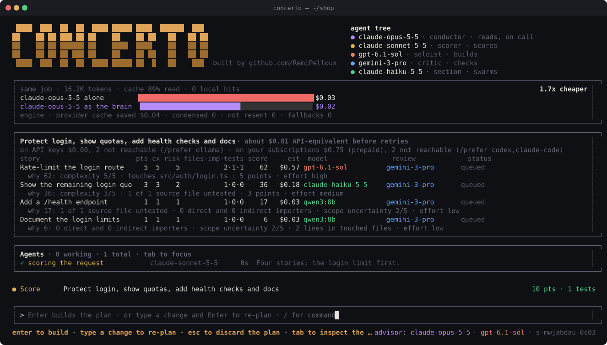
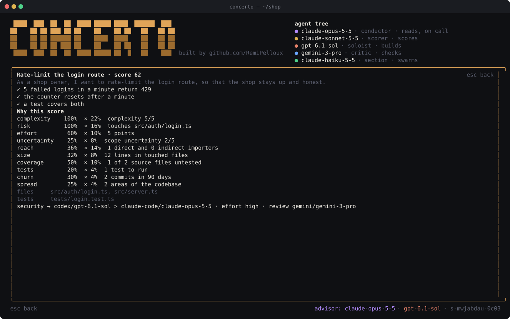
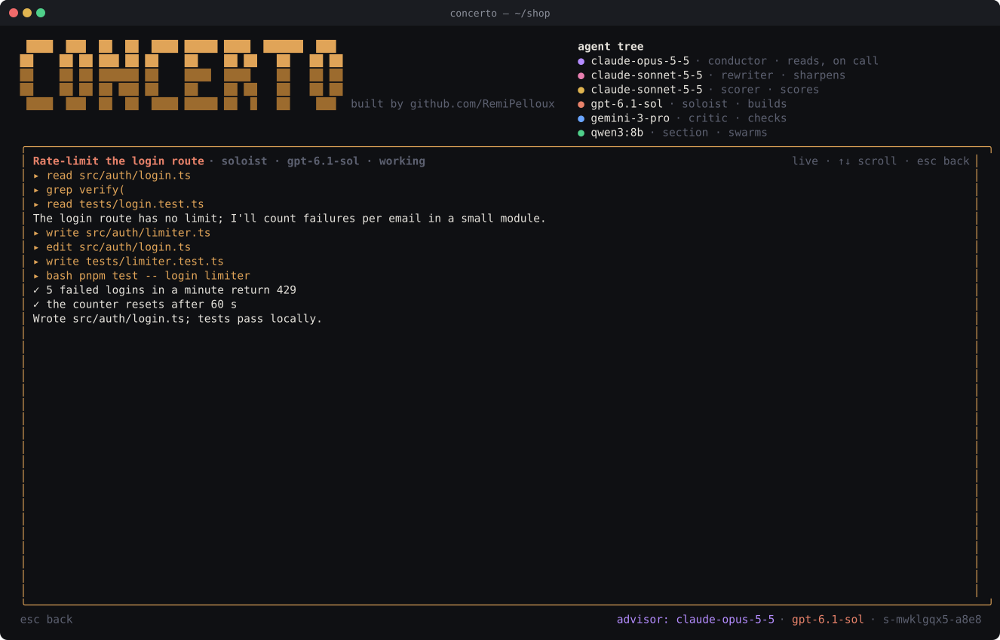
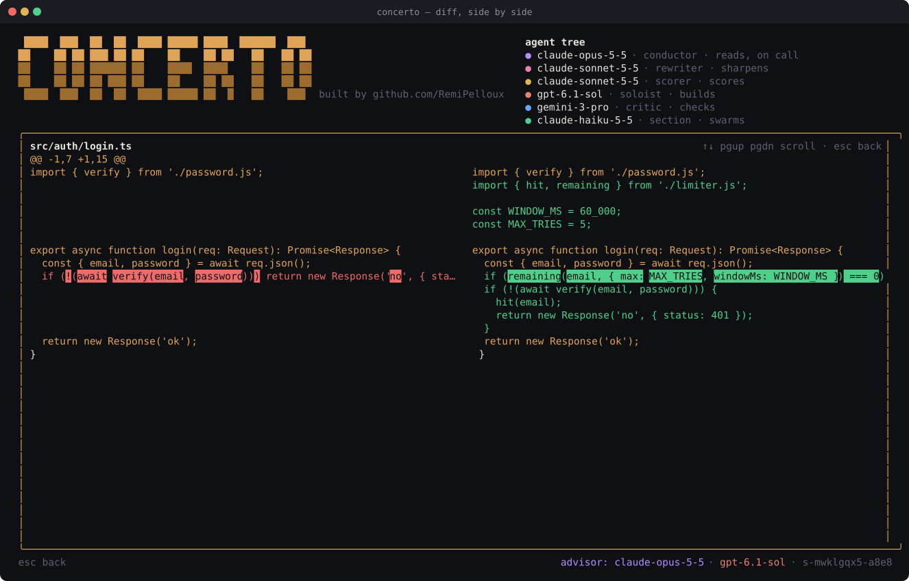
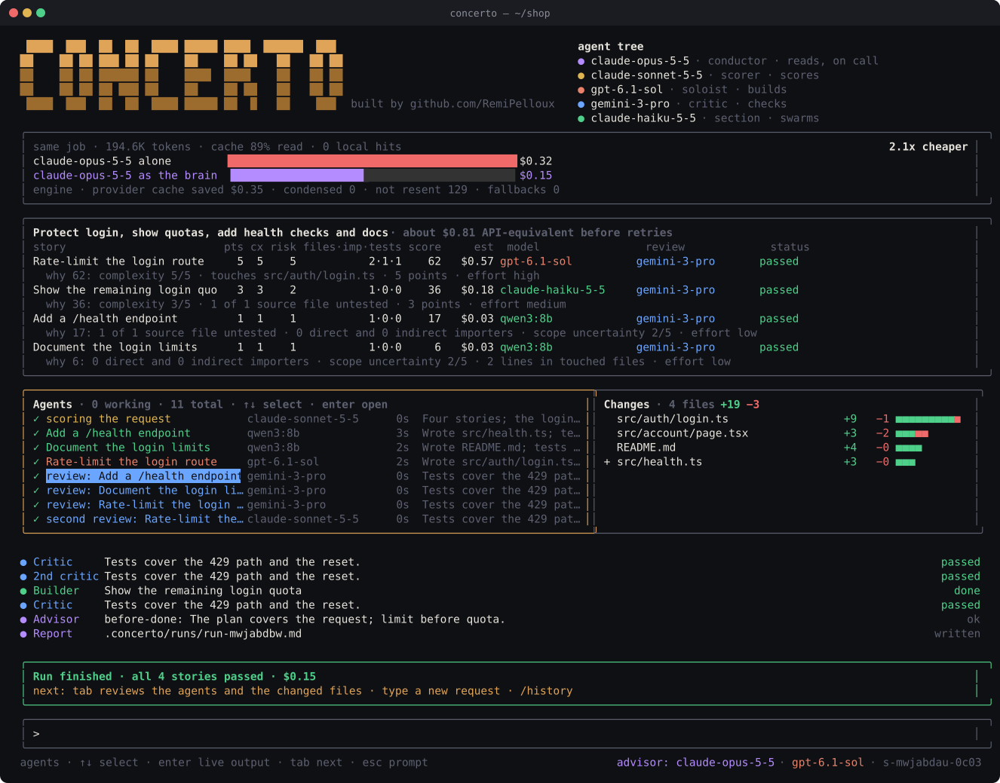

<p align="center">
  
</p>

<p align="center">
  <a href="https://github.com/RemiPelloux/Concerto/releases/latest"></a>
  <a href="https://github.com/RemiPelloux/Concerto/actions/workflows/ci.yml"></a>
  <a href="https://remipelloux.github.io/Concerto/"></a>
  
  
  <a href="LICENSE"></a>
</p>

# Concerto

**Hand it the whole feature. Get back code that was planned, built by the right model, tested,
reviewed by a second model and merged, while you watch every step.**

One coding agent working through a big request is slow, expensive and easy to fool: it marks its
own homework. Concerto runs it like a team. It splits your request into user stories and measures
how much of the repository each one touches. Each story goes to the model that fits it: Opus or
GPT-6.1 Sol for the risky work, Haiku or a free local model for the small stuff. Every story
builds in its own git worktree, has to pass *your* tests, and is then reviewed by a critic that
didn't write it. Only then is it merged into your folder.

It runs the agents you already pay for: Claude Code, Codex, Gemini CLI, Cursor, OpenCode, Goose,
Aider, pi and local models through Ollama or LM Studio. Concerto never holds an API key.

<p align="center"></p>

## Why teams pick Concerto

- **The right model for every story, automatically.** Each story is scored on ten factors (its
  reach in the import graph, untested code, risk, churn…) and routed to match. You see the reasons
  for each score, and can change any of it before the build starts.
- **Nothing reaches your branch unchecked.** Each story gets its own worktree, so parallel agents
  never collide. Then come your tests and type check, a mutation probe that catches tests that
  test nothing, a secret scan, and a critic from another vendor on risky work. The merge is
  three-way, so your own edits are safe.
- **It costs less than one frontier model alone.** The expensive model plans and wakes only at
  checkpoints; cheaper ones do the typing. Session reuse and context packs cut prompt tokens by 40%
  on a 10-story run. Each run's report puts its cost next to what the brain model alone would
  have cost.
- **You stay in charge.** Edit the plan before building, take back one story or one hunk, send a
  story back with a comment, pause, replay every model call, and share a run as one HTML page.
- **Safe enough for real repositories.**
  - **Sandbox:** your credentials are hidden from the agents, and their network is limited to the
    model providers.
  - **Policy:** paths no agent may touch, a spending ceiling, and reviews that must happen.
  - **Audit:** a signed log of every command an agent ran.
- **Fits your workflow.** Label a GitHub issue and get a pull request. Drive it from another agent
  over MCP, or from Neovim. Read each week's costs by model and repository, and send traces to
  OpenTelemetry.

**When not to use it:** for a one-file fix, one model alone is faster and cheaper; we measured it
([benchmark](docs/benchmark-single.md)). Concerto earns its overhead on features that span stories,
files and risk levels.

## See it

| | |
|---|---|
|  |  |
| **The plan, before anything is built.** Edit it, reroute a story, or press Enter. | **Every score explained**, factor by factor. |
|  |  |
| **Every agent, live.** | **Diffs side by side**, changed words marked. |

<p align="center"></p>

The screenshots are taken from the real interface by `pnpm docs:screens`, on a demo repository.

## Install

You need git and at least one coding agent logged in (`claude`, `codex`, `gemini`, `cursor-agent`,
`opencode`, `goose`, `aider` or `pi`), or Ollama.

| System | Command |
|---|---|
| macOS, Linux | `brew tap remipelloux/concerto https://github.com/RemiPelloux/Concerto && brew install concerto` |
| Windows | `scoop bucket add concerto https://github.com/RemiPelloux/Concerto; scoop install concerto` |
| Ubuntu, Debian | `sudo apt install ./concerto_<version>_amd64.deb`, from the [release](https://github.com/RemiPelloux/Concerto/releases/latest) |
| Nix | `nix profile install github:RemiPelloux/Concerto` |
| Docker | `docker run --rm -v "$PWD:/work" -w /work ghcr.io/remipelloux/concerto --help` |
| Any system, with Node 22+ | `curl -fsSL https://raw.githubusercontent.com/RemiPelloux/Concerto/main/scripts/install.sh \| sh` (or [install.ps1](scripts/install.ps1) on Windows) |

Every package is a single executable that needs no Node, except the script, which runs on your
Node. `concerto --update` updates it the way it was installed. Concerto checks for a new release
at most once a day and says so in one line; it sends nothing about you or your project, and
`CONCERTO_NO_UPDATE_CHECK=1` turns the check off.

## Quick start

Go to a project, ideally on a clean branch or a git worktree, because agents edit the files there:

```sh
cd ~/code/my-app
concerto
```

The first launch tests every model you have with one tiny prompt, keeps the ones that answer, asks
whether calls go through your subscriptions, your proxy or your API keys first, then plays a short
animated tour. Type a request, for example `Add CSV export to invoices. Done means: the tests
pass.`, press Enter to see the scored stories, and Enter again to build them.

## Commands

| Command | What it does |
|---|---|
| `concerto` | Start the terminal UI |
| `concerto "request"` | Start with a request already typed |
| `concerto --plan "request"` | Show the scored stories as JSON, build nothing |
| `concerto --plan --explain "request"` | Why each story got its score, model and estimate, in words |
| `concerto --template <name> "request"` | Plan in the shape of a saved template |
| `concerto --run "request"` | Score and build without the UI, for scripts and CI |
| `concerto --no-rewrite ...` | Score the request as typed: no rewriter, questions or design brief |
| `concerto --orca "request"` | Start the run in a new Orca worktree, in its own tab |
| `concerto --resume <id>` | Reopen a saved session and build what did not pass |
| `concerto --budget 5 ...` | Stop starting stories after $5 of API-equivalent spend |
| `concerto --gate 'pnpm test' ...` | A check every story must pass before review (repeatable) |
| `concerto --prefer 'ce-*' ...` | Try your proxy first for every model |
| `concerto --init` | Detect and test your models again, rewrite your config |
| `concerto --probe` | Retest the configured models |
| `concerto --doctor` | What is installed, linked, skipped, and why |
| `concerto --stats` | Tokens, cache hits and savings for this repository |
| `concerto --update-prices` | Fetch current model prices from models.dev for estimates and budgets |
| `concerto --insights` | What past runs say: pass rate, builds and cost per point per model, files that keep failing |
| `concerto --install-skills` | Teach the agents on this machine to use Concerto |

After a build, the report is in `.concerto/runs/`, ready to paste into a pull request.

Every launch has a session id, shown in the status line and in any error. Its log,
`.concerto/logs/<id>.log`, records the models in use, each phase, every agent's output and each
error with its stack: attach it when you report a bug. `.concerto/` is kept out of commits through
the repository's local git exclude.

Each session is also saved next to its log. `/history` lists them; `/history 2`, or
`concerto --resume <id>` from the shell, reopens one after a crash, an Esc or a failed review:
stories that passed stay passed, and Enter builds the rest.

## Inside the TUI

| Key | What it does |
|---|---|
| Enter | Score the request; Enter again builds the plan |
| Type, then Enter, while a plan waits | Re-plan with that change ("keep the routes public") |
| Type, then Enter, while agents build | A note every builder and critic reads from their next step |
| Enter on an empty prompt after a run | Build again only the stories that did not pass |
| Tab | Move between the prompt, the agents, the stories and the changed files |
| ↑ ↓ | Pick an agent, a story or a file |
| Enter on an agent | Its live output: what it reads, runs and says, as it happens |
| Enter on a story | Why it got its score: every factor, the files, the covering tests |
| d, m, s on a story | While a plan waits: drop it, merge the next story into it, split it |
| Enter on a file | Its diff: side by side with the changed words marked on a wide terminal |
| Esc | Close, go back to the prompt, discard a plan, or stop a build |

While agents work, their clocks tick every second and a preview shows the last lines of one of them
with how long ago it last printed. A minute of silence usually means it is running tests.

Type `/` for commands, with suggestions as you type and Tab to complete:

| Command | What it does |
|---|---|
| `/drop`, `/merge`, `/split`, `/retitle`, `/after` | Change the waiting plan: `/merge s4 s3` folds s4 into s3 |
| `/route`, `/reviewer`, `/effort` | Pick who builds or reviews a story, and how hard: `/route s1 claude-code/claude-opus-5-5` |
| `/hunks <story>`, `/reject <story> [n]` | After a run: list a story's hunks; take the whole story, or hunk n, back out (saved as a patch) |
| `/ask <story> <message>` | After a run: send a story back to its builder with a comment; only that story is rebuilt |
| `/pause`, `/continue` | Let the stories building finish and start no new one, then go on |
| `/template save <name>`, `/template use <name>` | Keep a plan's shape, or plan the next requests in it |
| `/insights` | Pass rate and cost per model in this repository, and the files that keep failing |
| `/history`, `/history 2` | Saved sessions of this project; reopen one and build what did not pass |
| `/history <words>` | Search saved sessions by request, file, model or result: `/history billing.ts failed` |
| `/redo <story>` | Queue a passed story to build again, after editing the plan if you like |
| `/replay [n\|id]` | Step through a session's model calls, ←→ between calls, each prompt and answer |
| `/share [n\|id]` | The run as one HTML file in `.concerto/share/`, keys and tokens redacted (`concerto --share <id>` too) |
| `/onboarding` | Replay the animated tour |
| `/setup` | Detect and test your models again, then pick the routing |
| `/config` | Every role, build route and review rule with its model: ↑↓ to move, Enter to open the list of models, Enter to pick one. Applies now and saves to the config in use |
| `/config auto` | Scan this machine (Claude Code, Codex and its servers, pi providers, API keys), test every model, save and apply the proposed organigram: who plans, scores, builds and reviews |
| `/models` | Each role's model chain and how stories route |
| `/doctor` | Models skipped after a failed probe, and why |
| `/probe` | Test every installed model again |
| `/session` | This session's id and the path of its log |
| `/budget 5`, `/prefer ce-*` | Change the budget or the provider order for this session |
| `/reload`, `/stats`, `/orca <request>`, `/clear`, `/quit`, `/help` | The rest |

## Who does the work

Concerto starts the agents itself. For every story it runs a builder (`claude -p`, `codex exec` or
`pi -p`) as a background process in the project folder, then a critic the same way, and the
conductor at its checkpoints. You do not open them, and they do not appear as separate tabs: you
watch them in Concerto's screen, and their work shows up as changes in the folder. Concerto never
commits; you review the diff.

### The rewriter

Before anything is scored, the rewriter role reads your request with the repository snapshot and
makes it precise: real file names, a clear "done means", no filler, nothing you did not ask for.

- **Questions.** When the request has readings that lead to different code, the TUI shows up to
  four questions in the log. Type your answers and press Enter, or press Enter alone to let the
  rewriter decide. `--run`, `--plan`, `--plain` and MCP runs never wait: the rewriter picks the
  sensible reading and logs each choice as `Assume`.
- **Design brief.** A request that spans several modules, adds a feature or hides a design decision
  gets a short brief: the approach, the files and why, the decisions and the alternatives rejected,
  the risks. The scorer, every builder and every critic read it, so the stories follow one design.
- **Effort floor.** The rewriter rates the whole request (`low` to `xhigh`). No story builds or is
  reviewed below that, so a hard request never gets a 1-point story built at low effort.

It runs on the `rewriter` role (Sonnet by default, low effort). Turn it off with `--no-rewrite` or
`"rewrite": false`.

### Learning from runs

Every finished story is recorded in `.concerto/outcomes.jsonl`: its factors, model, builds, cost
and result. After 20 stories, the score's weights are fitted to this repository: a factor that
went with failures and retries weighs more, one that did not weighs less, within a quarter to
double of its starting weight. Once a model has five paid stories here, the estimate uses its real
cost per point instead of list prices. Between two models of the same price, the one that passed
more stories here goes first. `concerto --insights` shows it all.

### How each story is checked

1. **Its own worktree.** The story starts from a snapshot of your folder, uncommitted work
   included, in a git worktree under `.concerto/worktrees/`, with `node_modules`, `.venv` and
   `.env` files linked in. Your index, HEAD and branches are not touched, and parallel stories
   cannot see each other's edits.
2. **Your tests.** After each build Concerto runs the project's test command (SmartTest, npm,
   pnpm, yarn, bun, pytest, go, cargo, PHPUnit, Maven or Gradle), then the `typecheck` and `lint`
   scripts, then your own gates, then the acceptance commands the scorer wrote. A red check goes
   back to the builder with its output; a test that passes on a rerun is reported as flaky.
3. **A broken condition.** On a story that adds tests, Concerto flips one condition the story
   added and runs the tests again. If they still pass, nothing tests that condition, and the
   builder is told to add a test that does.
4. **The critic,** with what already passed in hand. On a high-risk story a critic from another
   vendor reviews it too, and the conductor settles a disagreement.
5. **The merge.** A story that passes is merged into your folder with a three-way merge, so work
   that landed meanwhile is kept. When it conflicts with that work, as when several stories add to
   the same export list, the story is rebuilt on top of the current code, up to twice, as a
   developer would rebase. Your folder only ever receives a clean merge. The work of a story that
   still fails is saved as a patch in `.concerto/worktrees/`.

**Gates.** List your own checks in the config (`"gates": ["pnpm typecheck", "pnpm test"]`) or pass
`--gate` once per command. They run with the project's checks, in the story's folder, and a
failing one goes straight back to the builder with the end of its output; the critic is not
called. When the builder changed no file since the checks failed, they are not run again and the
attempt fails at once, so a stuck builder cannot spend attempts.

**The critic judges the story's own change.** Concerto snapshots the story's folder before its
first build and after each one, and gives the critic the files that changed in between and the
`git diff` that shows them.

**Builders end with `done`, `nothing-to-do` or `blocked`.** When the code already meets the story,
the builder changes nothing and says so, and the critic passes it if the acceptance items hold. A
builder that is `blocked` and changed no file goes straight to the conductor: no review of an
empty build, no blind retry.

## Teach your agents

`concerto --install-skills` (the installer runs it) adds three skills to Claude Code, Codex, pi, and
every agent that reads `~/.agents/skills`:

- `concerto`: when to hand a job to Concerto, which command to run, how to read the plan and the
  report.
- `concerto-config`: changing routes, models, provider preference and budget.
- `concerto-doctor`: fixing skipped models, failed logins, rate limits and failed runs.

Then ask any of them, for example, "plan this with Concerto" or "build it with Concerto in a new
Orca worktree".

## Concerto as MCP tools

`concerto --mcp` serves Concerto on stdio to any agent that speaks the Model Context Protocol:
Claude Code, Codex, Cursor and the rest. Five tools:

| Tool | Does |
|---|---|
| `concerto_plan` | Splits a request into scored stories and picks their models; changes no file |
| `concerto_build` | Builds a planned session: worktrees, checks, critics, merge |
| `concerto_run` | Both in one call |
| `concerto_status` | A saved session: its plan, or each story's result and the cost |
| `concerto_sessions` | This project's sessions, or those matching a query |

Each takes the project's absolute path as `cwd`, so one server serves every project. Long builds
report each log line as MCP progress. For Claude Code:

```sh
claude mcp add concerto -- concerto --mcp
```

## CI and pull requests

- `concerto --run --json "…"` prints one JSON event per line: `session`, `log`, `story`, `done`.
- `--commit` commits each merged story on its own: its title as the subject, the user story and
  who built and reviewed it in the body, only its files. Without it Concerto never commits.
- `--pr` starts a branch from a clean tree, commits per story, then pushes and opens a pull
  request with `gh`, the run report as its body.

On GitHub, the Concerto Action does this for an issue: copy
[examples/github/concerto.yml](examples/github/concerto.yml) to `.github/workflows/`, add
`CLAUDE_CODE_OAUTH_TOKEN` (from `claude setup-token`) as a secret, then label an issue `concerto`
or comment `/concerto <more instructions>`. Only people with write access can start a run, the
budget caps it, and the issue gets a link to the pull request. On GitLab,
[examples/gitlab/concerto.gitlab-ci.yml](examples/gitlab/concerto.gitlab-ci.yml) builds the
`CONCERTO_REQUEST` of a pipeline and pushes a merge request.

## Safety

- `--sandbox`, or `"sandbox": { "enabled": true }`, runs every agent and every check sandboxed:
  bubblewrap on Linux, `sandbox-exec` on macOS. The system is read-only and your credentials
  (`~/.ssh`, `~/.aws`, `gh`, `.npmrc`…) are hidden. The only network is to the model providers
  and `sandbox.allowHosts`.
- Every change is scanned for keys, tokens and password literals before review; one sends the
  story back and it never merges.
- Each run keeps a signed audit log of every command its agents ran and every host the sandbox
  refused, in `.concerto/audit/`.

[docs/security.md](docs/security.md) lists every place model output reaches a shell, a path or a
file, and what stands in the way.

## Costs, dashboard and traces

Every finished run is recorded, from every repository, in `~/.config/concerto/runs.jsonl`.

- `concerto --costs` breaks it down by ISO week, repository and model: calls, tokens and cost.
  `--since 7` keeps the last seven days; `--csv` prints it as CSV for a spreadsheet.
- `concerto --dashboard` writes one page of every run: cost per week, pass rate per repository,
  cost per model and the slowest stories. It needs no server and no network.
- With `OTEL_EXPORTER_OTLP_ENDPOINT` set (or `OTEL_EXPORTER_OTLP_TRACES_ENDPOINT`, and
  `OTEL_EXPORTER_OTLP_HEADERS` for a key), each run is sent as an OpenTelemetry trace: the run, a
  span per story, and a client span per model call with the GenAI attributes
  (`gen_ai.request.model`, `gen_ai.usage.input_tokens`, `gen_ai.usage.output_tokens`) and its cost.
  Any OTLP collector works: Jaeger, Grafana Tempo, Honeycomb, Datadog.

## Neovim

[`editors/nvim`](editors/nvim) adds `:Concerto` and `:ConcertoPlan`. Over a visual selection,
`:'<,'>Concerto round to cents` starts Concerto with the file, the lines and the selected code;
`:ConcertoPlan` shows the plan without building.

## Use with Orca

- **From any Orca terminal:** `concerto --orca "request"` creates a fresh worktree of the current
  repository and starts Concerto in a new tab there, so the run never touches your branch.
- **One click:** in Orca, open Settings, then the terminal quick commands, and add a command with
  the label `Concerto` and the command `concerto`. It opens the TUI in the current worktree.
- **From your agents:** with the skills installed, Claude Code, Codex or pi running in Orca call
  `concerto --plan` or `concerto --orca` when you ask them to.
- **The Concerto panel:** the `orca-plugin/` folder is an Orca plugin (Orca 1.4 or later). In
  Orca, open Settings, then Plugins, and install it from that local folder. It adds a Concerto
  panel to the right sidebar: pick Plan, Build here or New worktree, write a request, set an
  optional budget, pick a terminal of the focused worktree that shows a shell prompt, and send.
  Doctor, Models, Probe and Stats run from the same panel. It asks to read the worktree's terminal
  list and to type into the terminal you pick, nothing else.

## How a story is scored

The scorer model writes each story with points, complexity, risk, scope uncertainty and the files
it will touch. Concerto then measures those files in your repository and computes a score from 0
to 100 from ten factors:

| From the model | Weight | Measured in the repository | Weight |
|---|---|---|---|
| Complexity | 22% | Reach: files importing them, direct ones count double | 14% |
| Risk, never below 4/5 for auth, payments, migrations, CI | 16% | Coverage gap: touched code with no test | 10% |
| Effort (story points) | 10% | Size of the touched files | 8% |
| Scope uncertainty | 8% | Tests to run, churn over 90 days, areas touched | 4% each |

Tests come from [SmartTest](https://github.com/RemiPelloux/SmarttyTest) when the repository uses it,
otherwise from Concerto's own import graph (TypeScript, JavaScript, Python, Go, Rust, PHP, Java,
Kotlin, C#, Ruby, Swift; [benchmark](docs/language-benchmark.md)). A misremembered path is
matched to the real file. If a story names no file, the model's four factors decide alone. Every
score comes with its top three reasons, for example `why 64: complexity 4/5 · touches
src/auth/session.ts · 2 of 2 source files untested`.

The score picks the builder and its effort:

| Story | Builder | Reviewer |
|---|---|---|
| UI or UX | Opus 5.5 | GPT-6 Astra |
| Score 55 or more | Opus 5.5 | Sonnet 5.5 |
| Score 25 to 54 | GPT-6.1 Sol | Sonnet 5.5 |
| Score under 25 | Haiku 5.5 | Sonnet 5.5 |

Effort follows the score: low under 25, medium under 50, high under 75, extra high above, never
under the rewriter's floor for the request. Critics scale the same way, never below the critic
role's own effort; a review rule can name its own (`"effort": "high"`). Any entry in a chain can
pin the effort its model runs at, whatever the story asks:

```json
"reviews": [{ "minScore": 55, "models": ["claude-code/claude-opus-5-5#high", "codex/gpt-6.1-sol#medium"] }]
```

`/effort <story> <level>` changes one story before you build. Each
model has a fallback chain, so a rate limit or an outage moves the call to the next way of reaching
the same model. A story that fails review twice wakes the conductor, and its advice goes into one
last attempt.

## Saving tokens

- Claude Code starts without your plugins and MCP servers: about 600 tokens of context, not 131,000.
- System prompts are byte-identical between calls, so provider caches keep hitting.
- A resumed session is not sent what it already has.
- Critiques and logs lose noise (ANSI codes, spinners, repeated lines) before going back to a model.
- Scoring the same request twice, even worded differently, is answered from a local cache, with no
  tokens spent. Requests that name different numbers never match.
- Each builder sees only its story's neighbours in the plan, and a context pack of what its files
  export, so it opens fewer files to find its way. Critics, who read the diff, get no repository map.
- The import graph's parse of every file is kept between runs; only changed files are read again.
- `concerto --stats` shows the provider cache hit rate per role.
- Agents are told to use [rtk](https://github.com/rtk-ai/rtk) when it is installed.

## Configuration

Your config is `~/.config/concerto/config.json`, written by the first launch. A
`concerto.config.json` in a project is merged over it: what the team commits there (routes,
reviewers, budgets, policy) wins, objects merge key by key, lists are replaced, and each person keeps
their own models and logins. [examples/concerto.config.full.json](examples/concerto.config.full.json)
shows a full one with 37 working models.

A team's policy and notifications go in the project config:

```json
"policy": {
  "protectedPaths": ["infra/", "**/*.pem"],
  "blockedModels": ["ollama/*"],
  "maxRunUsd": 20,
  "requireReview": [{ "paths": ["src/auth/**"], "role": "security" }]
},
"notify": [
  { "kind": "slack", "url": "${SLACK_WEBHOOK}", "on": ["done", "failed", "plan"] }
]
```

A story that changes a protected path goes back to its builder and can never pass or merge; the
log says which file and which rule. Blocked models leave every chain. `maxRunUsd` caps `budgetUsd`
and `--budget`. A required review runs the named custom review role on every story touching those
paths. Notifications go to Slack, Discord or any webhook when a run ends or a plan waits for you;
`${VAR}` in a URL reads the environment, so the secret stays out of the repository.

On Linux, Codex's sandbox stops Node from starting programs, so tests that run git or sh fail
inside a Codex build. Concerto tells Codex builders so, and the gates and the critic run those
tests outside the sandbox. `"codexFullAccess": true` runs Codex's builders and critics without a
sandbox, with your user permissions. It is off by default; turn it on only in a checkout you would
let any command touch.

Model names look like `claude-code/claude-opus-5-5` (Claude subscription), `codex/gpt-6.1-sol`
(ChatGPT subscription), `codex@ce-gpt/gpt-6.1-sol` (a Codex profile, such as a proxy), or
`openai/gpt-6.1-sol` (any provider in pi). Five more coding agents work the same way, each with
the login or providers it is set up with:

| Ref | Runs | Reviewers, who only read |
|---|---|---|
| `gemini/<model>` | Gemini CLI | plan mode |
| `cursor/<model>` | Cursor's agent | plan mode |
| `opencode/<provider>/<model>` | OpenCode (`/setup` or `concerto --init` lists its models) | the plan agent |
| `goose/<provider>/<model>` | Goose | chat mode, no tools |
| `aider/<model>` | Aider, which never commits | ask mode |

Builders get each CLI's own write access; Concerto still works in a worktree and merges the
result. Prompts go in on stdin, and token use and cost are read from each CLI's output.

Models on your own machine work too: `ollama/qwen3:8b` through Ollama (port 11434, or
`OLLAMA_HOST`) and `lmstudio/<model>` through LM Studio (port 1234, or `LMSTUDIO_HOST`). They cost
nothing, `/setup` (or `concerto --init`) adds the ones the server has at tier 1, and they get a small tool set of
their own: read and list files, and write them when building, inside the story's folder, with no
shell. That suits scoring, diff reviews and small stories.

Roles of your own go in `customRoles`. A `review` role runs after the critic passes a story it
applies to, and failing it sends the story back to its builder with the review. A `build` role
works on a passed story in its worktree before the merge. Each takes its instructions as text or
as a file of the repository, and applies by tag, by path glob, or to every story above `minScore`:

```json
"customRoles": [
  { "name": "security", "kind": "review", "instructions": "docs/SECURITY_REVIEW.md", "tags": ["auth", "payments"], "models": ["codex/gpt-6.1-sol"] },
  { "name": "migrations", "kind": "review", "instructions": "Fail any migration that cannot be rolled back.", "paths": ["**/migrations/**"] },
  { "name": "docs", "kind": "build", "instructions": "Update README.md for what the story changed.", "paths": ["src/**"], "minTier": 2 }
]
```

The run report lists every model call by model, with its tokens and cost.

How stories are checked is set in the same file:

```json
{
  "checks": { "test": "pnpm test", "typecheck": "pnpm typecheck", "lint": false, "timeoutMinutes": 10 },
  "isolation": "worktree",
  "behaviour": { "serve": "npm run dev", "routes": ["/", "/api/health"], "readySeconds": 60 }
}
```

Spending is capped per run (`budgetUsd`, or `--budget`), per story, per day and per repository,
and each budget warns once at 80 %. Per account (`claude-code`, `codex`, `codex@ce-gpt` or a pi
provider), `limits` caps what Concerto spends in a rolling window and sends later calls
elsewhere; an account that answers with a rate limit is paused until the reset it names:

```json
{
  "budgets": { "story": 2, "day": 20, "repo": 200 },
  "limits": { "claude-code": { "windowHours": 5, "maxUsd": 40 } }
}
```

When a plan waits for Enter, Concerto shows what it would cost on your subscriptions, through
Codex profiles and on API keys, with the `/prefer` command that picks each.

Each check is a command, `false` to turn it off, or left out to let Concerto detect it.
`"isolation": "off"` builds every story in the folder itself. `behaviour` is for web projects:
the server (which must read `PORT`) is started before and after each story, and the critic sees
which routes changed.

## Cheaper API access

When your subscriptions run out, an API gateway that serves GPT, Claude, DeepSeek and Grok behind
one key is the simplest fallback. I use [CodexEverywhere](https://codex-everywhere.com/home?aff=H9TB6LJQJMEU).
Add it to pi or as a Codex profile with providers named `ce-gpt`, `ce-claude`, `ce-deepseek` and
`ce-grok`, and Concerto picks them up.

## Accessibility and languages

- `concerto --plain "…"` says the plan and every event as plain sentences, one per line, and asks
  before building: for screen readers, braille displays and logs.
- Themes: `"ui": { "theme": "high-contrast" }`, `"colorblind"` (pass in blue, fail in vermilion,
  never red against green) or `"mono"`; `NO_COLOR=1` always gives mono.
- Every single-key action can be remapped, and Tab and the arrows can get extra keys:
  `"ui": { "keys": { "drop": "x", "down": "j", "up": "k" } }`.
- The TUI speaks English and French (`"ui": { "language": "fr" }`, or `"auto"` to follow `LANG`);
  [docs/fr](docs/fr/README.md) has the essentials in French.

## Documentation

- [Reference](docs/reference.md): every flag, slash command and config key, generated from the code.
- [Recipes](docs/recipes.md): spend less, work as a team, build issues in CI, run untrusted work safely…
- [Failures](docs/failures.md): every error message, why it happens and what to do; each one is tested.
- [Security](docs/security.md), the [language benchmark](docs/language-benchmark.md) and the
  [benchmark against one model alone](docs/benchmark-single.md).

## Roadmap

What is missing and what comes next: [ROADMAP.md](ROADMAP.md).

## Development

```sh
git clone https://github.com/RemiPelloux/Concerto && cd Concerto
pnpm install && git config core.hooksPath .githooks
pnpm dev                           # run from source
pnpm check                         # types, lint, tests, Pelloux audit, build, perf budgets
```

Imports use the `#src/...`, `#tests/...` and `#scripts/...` aliases (package.json `imports`),
never `../..` paths: the `source` condition points `#src` at TypeScript in development and tests,
and at `dist/` once built. The code
follows the [Pelloux Guidelines](https://github.com/RemiPelloux/pelloux-guidelines). The
pre-commit hook runs the tests your change can reach, through SmartTest. Security notes are in
[SECURITY.md](SECURITY.md).

`sh scripts/package.sh` builds the release packages in `out/`. Publishing a GitHub release runs
the same script in CI, installs both packages with their installers on Linux, macOS and Windows,
and attaches them only when all three pass.

## License

MIT. Built by [github.com/RemiPelloux](https://github.com/RemiPelloux).
