<p align="center">
  
</p>

<p align="center">
  <a href="https://github.com/RemiPelloux/Concerto/actions/workflows/ci.yml"></a>
  <a href="https://remipelloux.github.io/Concerto/"></a>
  
  
  <a href="LICENSE"></a>
</p>

# Concerto

Concerto is a terminal orchestrator for coding agents. You describe a job, a scorer model splits
it into user stories with points, complexity and risk, and each story goes to the model that fits
it: Opus 5.5 for hard and UI work, GPT-6.1 Sol for the rest. A critic tries to break every story
before it counts as done, and GPT-6 Astra reviews the UI ones. Fable 5.2 conducts. It reads the
whole session at three checkpoints and never writes code.

It runs on what you already pay for. Claude models go through your **Claude Code** subscription,
GPT models through your **ChatGPT** subscription via Codex, and anything else through
[pi](https://github.com/badlogic/pi-mono) with whatever API keys pi holds. Concerto never sees a key.

Documentation: [remipelloux.github.io/Concerto](https://remipelloux.github.io/Concerto/)

## Usage

```sh
git clone https://github.com/RemiPelloux/Concerto && cd Concerto
npm install

npm run dev                                   # the TUI
npm run dev -- "Move the API to Rust. Done means: every test passes."
npm run dev -- --plan "Add dark mode to settings"   # scored stories as JSON, nothing is built
npm run dev -- --run "Add a CSV export"       # score and build without the TUI (scripts, CI)
npm run dev -- --models                       # reachable models, role defaults, sample routes
```

Needs Node 22+, Python 3.10+ for the audit, and at least one of `claude` (logged in), `codex`
(logged in with ChatGPT) or `pi` (with a provider) on your PATH. `--models` shows what Concerto
can reach.

In the TUI, Enter scores the request and shows the stories with their model. Enter again performs
the plan, and Esc discards it. During a run, Esc interrupts it. Builders edit files in the
directory you start Concerto from, so start it in a git worktree or on a clean branch.

## From request to stories

<p align="center">
  
</p>

The scorer returns each story with Fibonacci `points` (1, 2, 3, 5, 8, 13), `complexity`, `risk`
and `value` from 1 to 5, `tags` and `dependsOn`. Concerto computes the difficulty itself, so the
number does not depend on a model's mood:

```
score = 50% complexity + 30% risk + 20% points        0 to 100
```

Then the first matching route in `concerto.config.json` wins:

| Route | When | Builder | Reviewer |
|---|---|---|---|
| `ux-build` | tagged ui, ux, frontend or design-system | Opus 5.5, effort high | GPT-6 Astra |
| `complex-build` | score 55 or more | Opus 5.5, effort high | Sonnet 5.5 |
| `light-build` | everything else | GPT-6.1 Sol, effort medium | Sonnet 5.5 |

Each route lists models in order of preference: `claude-code/claude-opus-5-5` first, then
`anthropic/claude-opus-5-5` through pi. When none is reachable, Concerto falls back to the cheapest
model at the right tier. Prepaid subscription models count at a quarter of their list price when
it compares costs (`costFactor`).

Stories with no dependency between them run in the same wave. Opus stories in a wave run one
after another, and Sol stories run in parallel (6 at most). A story that fails review gets one
retry with the critique. If it fails twice, the conductor is woken to say whether it is a root
cause or a rabbit hole.

## Three backends

| Prefix | Runs through | Billing | How it is called |
|---|---|---|---|
| `claude-code/` | Claude Code CLI | your Claude subscription | `claude -p --output-format stream-json`, with user settings, plugins and MCP servers off |
| `codex/` | Codex CLI | your ChatGPT subscription | `codex exec --json`, read-only sandbox for reviewers, workspace-write for builders |
| anything else | pi | the provider's API key in pi | `pi -p --mode json` |

Starting Claude Code without your settings matters. A bare "ok" costs about 600 tokens of
context instead of about 131,000 with every plugin and MCP server loaded.

## Cache

<p align="center">
  
</p>

1. **Stable prefix.** Each role's system prompt is one file, `.concerto/prompts/<role>-<hash>.md`.
   It holds the Pelloux guidelines and then the role brief, with no dates, paths or story text, so
   the provider's prompt cache matches every call. Codex has no system prompt flag, so the same
   text opens the message, and it is still a stable prefix.
2. **Warm sessions.** The conductor keeps one session per run, and each story keeps its own for the
   retry. A resumed turn reads the earlier turns from the cache.
3. **Local response cache.** Read-only calls are stored in `.concerto/cache/`, keyed on model, role,
   prompt file and prompt. Scoring the same request again took 0.9 s instead of 21 s, with no tokens.

The cost panel in the TUI shows the cache read rate, the dollars cache reads saved, the local hits,
and what the same tokens would have cost on the conductor model alone. Costs are API-equivalent:
on a subscription they show what you would have paid, not what you were charged.

## Configuration

Concerto reads the first file it finds: `$CONCERTO_CONFIG`, `./concerto.config.json`,
`~/.config/concerto/config.json`, then the bundled [concerto.config.json](concerto.config.json).

```jsonc
{
  "models": { "codex/gpt-6.1-sol": { "tier": 4 }, "deepseek/deepseek-v4-flash": { "tier": 1, "costFactor": 1 } },
  "routes": [
    { "name": "ux-build", "tags": ["ui", "ux"], "role": "soloist", "models": ["claude-code/claude-opus-5-5"], "effort": "high" }
  ],
  "reviews": [{ "tags": ["ui", "ux"], "models": ["codex/gpt-6-astra"] }],
  "roles": { "conductor": { "minTier": 5, "effort": "high", "tools": ["read"], "models": ["claude-code/claude-fable-5-2"] } },
  "skills": [{ "tags": ["ui"], "paths": ["~/.claude/skills/impeccable"] }]
}
```

Skills are attached by story tag. UI stories get `impeccable`, `design-taste-frontend` and
`web-design-guidelines`, and copy stories get `humanizer`. pi loads them with `--skill`. Claude
Code and Codex get the paths and read the `SKILL.md` files themselves. Missing paths are skipped.

## Development

The code follows the [Pelloux Guidelines](https://github.com/RemiPelloux/pelloux-guidelines):
files up to 400 lines, functions up to 25, three parameters, no debug output. Tests run through
[SmartTest](https://github.com/RemiPelloux/SmarttyTest), which runs only the tests a change
can reach.

```sh
npm run check            # typecheck, eslint, vitest, pelloux audit
npm run test:affected    # only the tests your change reaches
```

The pre-commit hook in `.githooks/` runs SmartTest on the staged change, then the Pelloux audit and
the type check. After cloning, run `git config core.hooksPath .githooks` once. CI runs `npm run check`.

Concerto's own agents use SmartTest too. When the target repository has a `smarttest.config.*`,
builders and critics run `npx smarttest run --affected` instead of the whole suite.

```
src/
  cli.tsx, headless.ts   entry points
  config/                config schema and lookup
  models/                discovery (claude, codex, pi), prices, router
  orchestrator/          score, route, build, review, consult, perform
  runner/                one adapter per backend over a shared JSONL spawner
  cache/                 prefix files, response cache, cost ledger
  state/, ui/            the store and the Ink components
prompts/                 one system prompt per role
docs/                    the GitHub Pages site
```

## License

MIT
