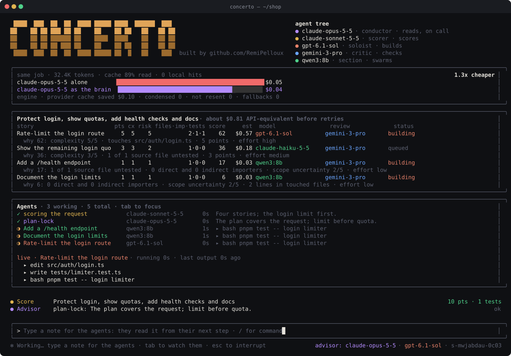

# Concerto, en français

Concerto découpe une demande de code en user stories notées, envoie chacune au modèle qui lui
convient (Claude Code, Codex, Gemini CLI, Cursor, OpenCode, Goose, Aider, pi ou un modèle local),
construit chaque story dans son propre worktree git, la vérifie avec les tests du projet et un
critique, puis la fusionne dans votre dossier. Le [README anglais](../../README.md) est la
référence complète ; cette page en reprend l'essentiel.

Depuis la 1.0, la configuration, les options, les commandes et le format des événements sont
stables : rien ne casse avant la 2.0 ([stabilité](../stability.md), en anglais). Pour passer
d'une 0.x : `concerto --update`, puis `concerto --migrate-config` si vous voulez écrire la version
dans vos fichiers ([guide](../migrating-to-1.0.md)).



## Installer

Linux et macOS :

```sh
curl -fsSL https://raw.githubusercontent.com/RemiPelloux/Concerto/main/scripts/install.sh | sh
```

Windows (PowerShell) :

```powershell
irm https://raw.githubusercontent.com/RemiPelloux/Concerto/main/scripts/install.ps1 | iex
```

Sans Node : `brew tap remipelloux/concerto https://github.com/RemiPelloux/Concerto && brew install concerto`,
`scoop bucket add concerto https://github.com/RemiPelloux/Concerto; scoop install concerto`, le
`.deb` de la release pour apt, ou l'image `ghcr.io/remipelloux/concerto`.

Il faut git et au moins un agent connecté : `claude`, `codex`, `gemini`, `cursor-agent`,
`opencode`, `goose`, `aider` ou `pi`.

## Démarrer

```sh
cd mon-projet
concerto "ajoute une route /health qui renvoie 200, avec un test"
```

Concerto note la demande et affiche le plan : les stories, leur score, le modèle qui construit et
celui qui relit, et une estimation du coût. Entrée lance la construction ; tapez une modification
pour refaire le plan, ou Échap pour l'abandonner. Pendant le travail, tapez une note : les agents
la lisent à leur prochaine étape.

L'interface parle français quand `LANG` commence par `fr`, ou avec `"ui": { "language": "fr" }`
dans la configuration.

## Les commandes utiles

| Commande | Ce qu'elle fait |
|---|---|
| `concerto --plan --explain "…"` | Le plan et pourquoi chaque story a son score et son modèle, sans rien construire |
| `concerto --run --json "…"` | Sans interface, un événement JSON par ligne |
| `concerto --run --pr "…"` | Une branche, un commit par story, puis une pull request |
| `concerto --no-rewrite "…"` | Évaluer la demande telle quelle : pas de réécriture, de questions ni de note de conception |
| `concerto --plain "…"` | Tout le déroulé en phrases, pour les lecteurs d'écran |
| `concerto --sandbox "…"` | Chaque agent dans un bac à sable : réseau limité aux fournisseurs de modèles, secrets cachés |
| `concerto --costs --since 7` | Les coûts de la semaine par dépôt et par modèle (`--csv` pour un tableur) |
| `concerto --mcp` | Concerto comme outils MCP pour d'autres agents |
| `/history billing.ts failed` | Retrouver une ancienne session |
| `/reject <story> [n]` | Retirer une story fusionnée, ou un seul de ses morceaux |
| `/ask <story> <message>` | Renvoyer une story à son constructeur avec un commentaire |

Toutes les options, commandes et clés de configuration sont dans la [référence](../reference.md),
chaque message d'erreur avec quoi faire dans [failures](../failures.md), et les usages courants
dans les [recettes](../recipes.md).

## Sécurité

Activez le bac à sable (`--sandbox`) pour du travail dont vous n'êtes pas sûr. Chaque modification
est analysée pour y trouver des clés et des mots de passe avant d'être relue ou fusionnée, et
chaque run garde un journal d'audit signé de toutes les commandes lancées. Voir
[security.md](../security.md).
